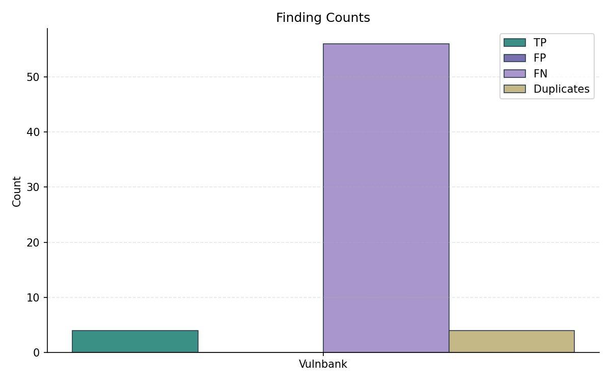
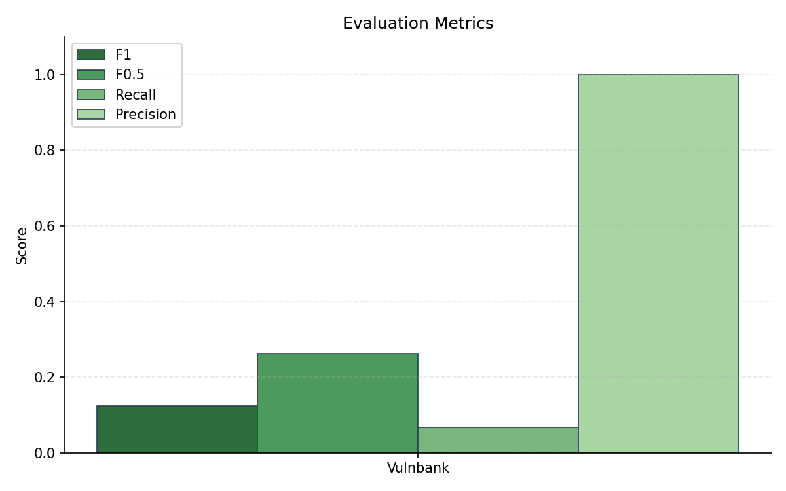
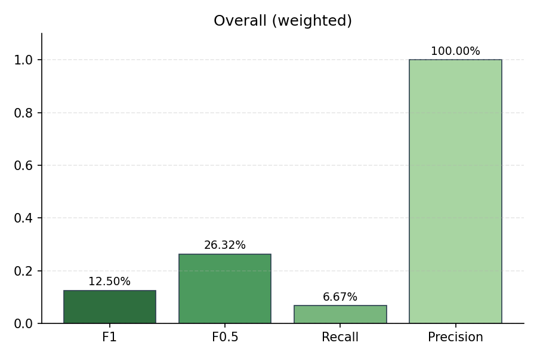

# Evaluation Summary

## Overall (unweighted)

| Metric | Value |
|--------|-------|
| Precision | 100.00% |
| Recall | 6.67% |
| F1 | 12.50% |
| F0.5 | 26.32% |
| Severity Score | 200 |

## Overall (weighted)

| Metric | Value |
|--------|-------|
| Precision | 100.00% |
| Recall | 6.67% |
| F1 | 12.50% |
| F0.5 | 26.32% |
| Severity Score | 200 |

## Per-Subset Results

| Subset | TP | FP | FN | DUP | Precision | Recall | F1 | F0.5 | Severity |
|--------|----|----|----|----|-----------|--------|----|----|------|
| Vulnbank | 4 | 0 | 56 | 4 | 100.00% | 6.67% | 12.50% | 26.32% | 200 |

## Plots

