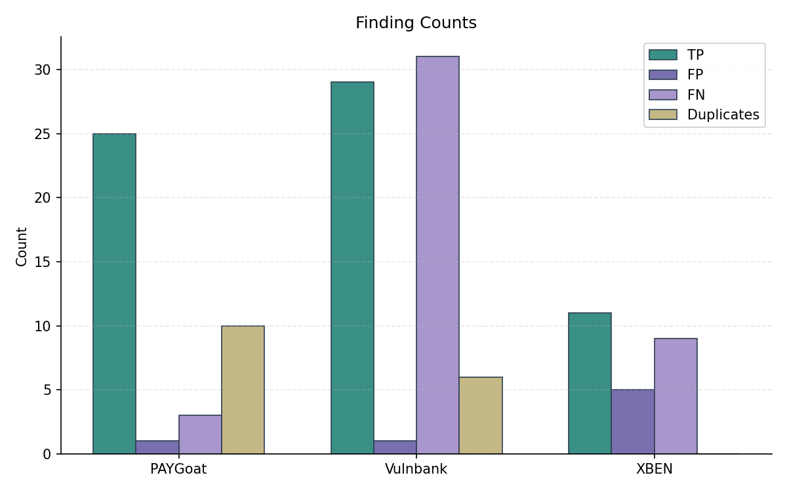
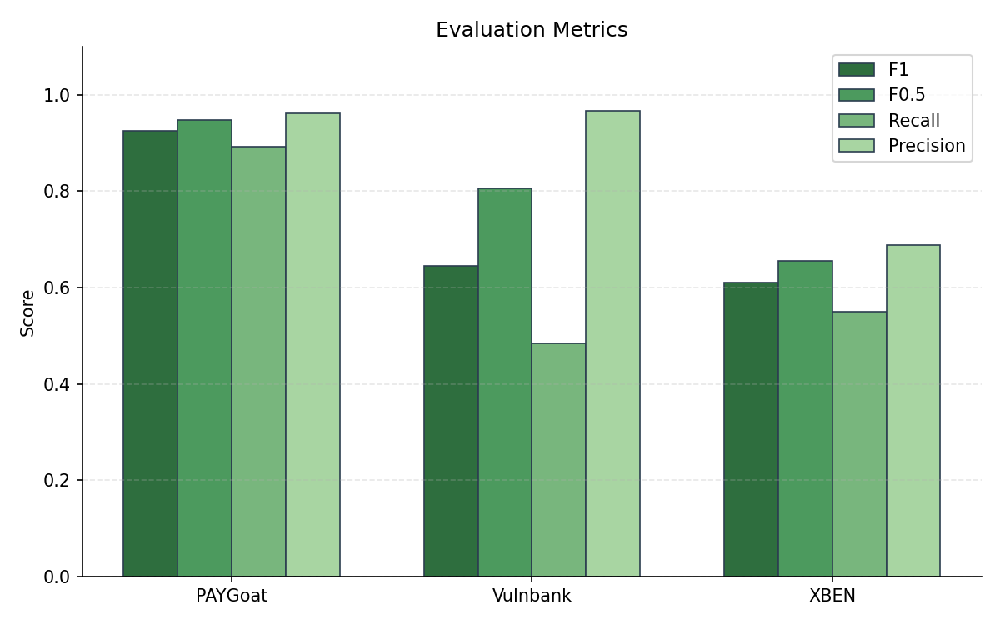
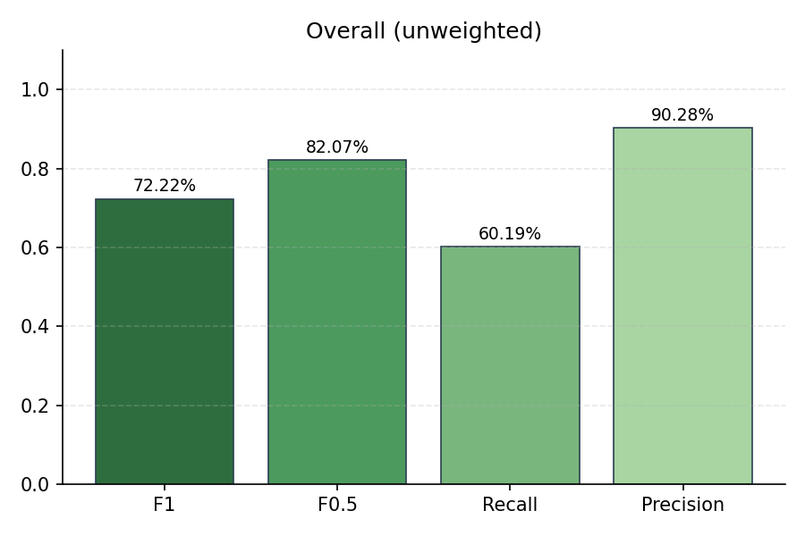

# Evaluation Summary

## Overall (unweighted)

| Metric | Value |
|--------|-------|
| Precision | 90.28% |
| Recall | 60.19% |
| F1 | 72.22% |
| F0.5 | 82.07% |
| Severity Score | 1737 |

## Overall (weighted)

| Metric | Value |
|--------|-------|
| Precision | 90.28% |
| Recall | 60.19% |
| F1 | 72.22% |
| F0.5 | 82.07% |
| Severity Score | 579 |

## Per-Subset Results

| Subset | TP | FP | FN | DUP | Precision | Recall | F1 | F0.5 | Severity |
|--------|----|----|----|----|-----------|--------|----|----|------|
| PAYGoat | 25 | 1 | 3 | 10 | 96.15% | 89.29% | 92.59% | 94.70% | 671 |
| Vulnbank | 29 | 1 | 31 | 6 | 96.67% | 48.33% | 64.44% | 80.56% | 841 |
| XBEN | 11 | 5 | 9 | 0 | 68.75% | 55.00% | 61.11% | 65.48% | 225 |

## Plots

