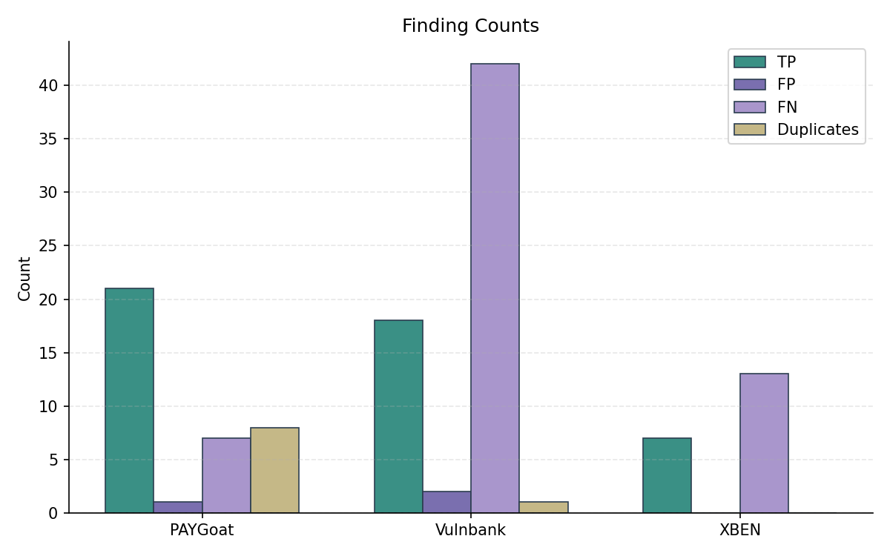
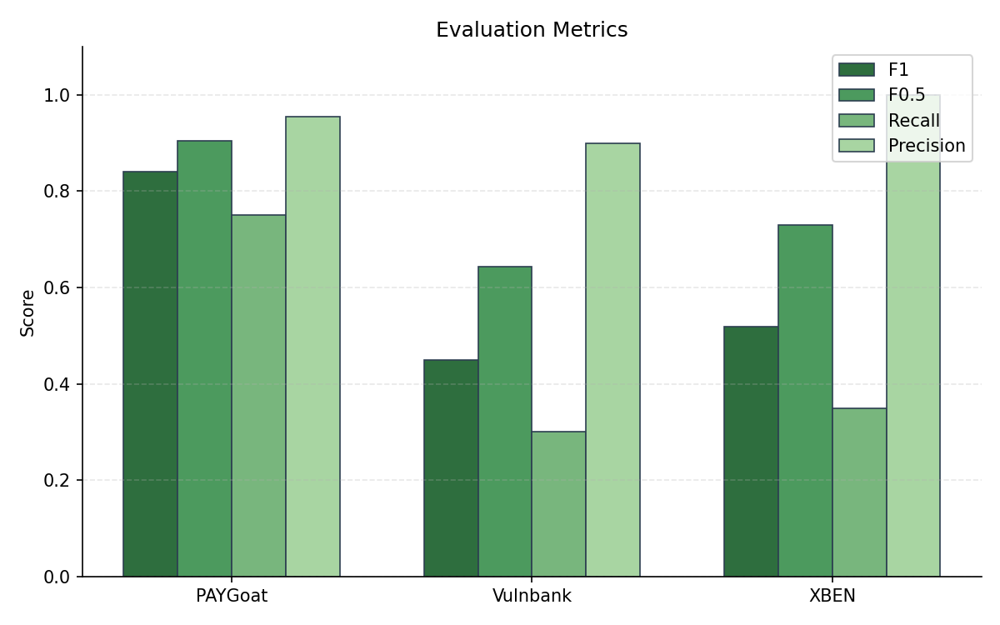
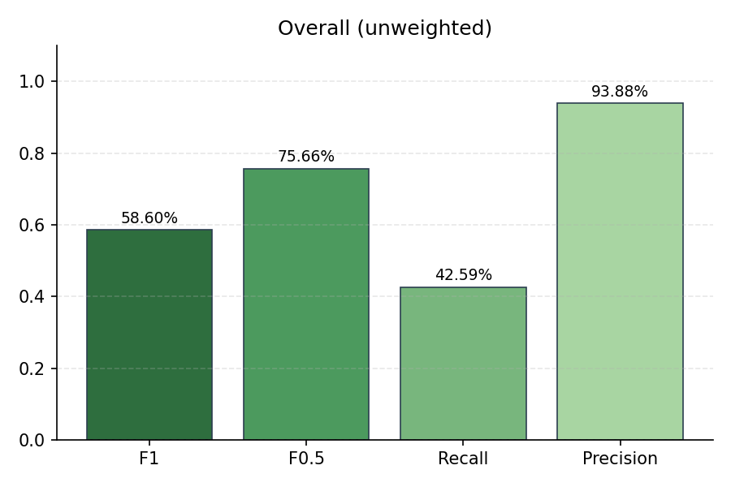
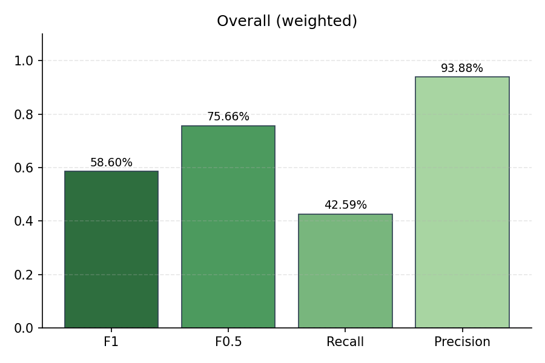

# Evaluation Summary

## Overall (unweighted)

| Metric | Value |
|--------|-------|
| Precision | 93.88% |
| Recall | 42.59% |
| F1 | 58.60% |
| F0.5 | 75.66% |
| Severity Score | 1274 |

## Overall (weighted)

| Metric | Value |
|--------|-------|
| Precision | 93.88% |
| Recall | 42.59% |
| F1 | 58.60% |
| F0.5 | 75.66% |
| Severity Score | 425 |

## Per-Subset Results

| Subset | TP | FP | FN | DUP | Precision | Recall | F1 | F0.5 | Severity |
|--------|----|----|----|----|-----------|--------|----|----|------|
| PAYGoat | 21 | 1 | 7 | 8 | 95.45% | 75.00% | 84.00% | 90.52% | 581 |
| Vulnbank | 18 | 2 | 42 | 1 | 90.00% | 30.00% | 45.00% | 64.29% | 558 |
| XBEN | 7 | 0 | 13 | 0 | 100.00% | 35.00% | 51.85% | 72.92% | 135 |

## Plots

