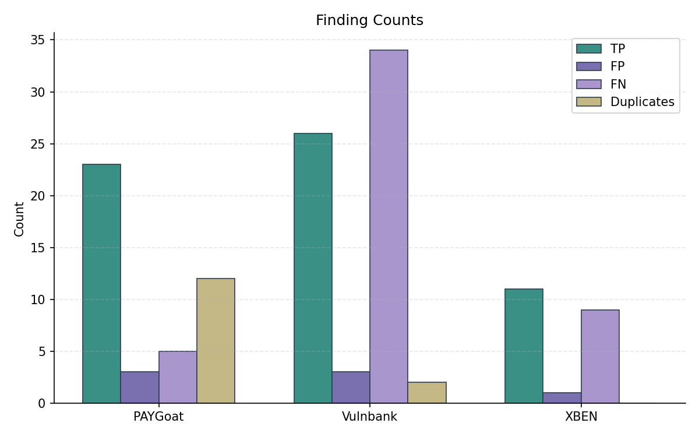
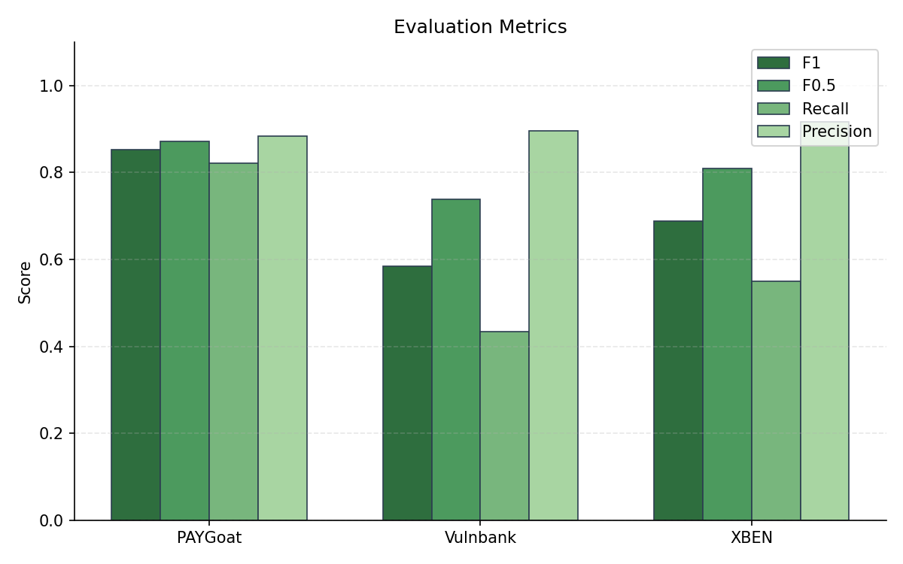
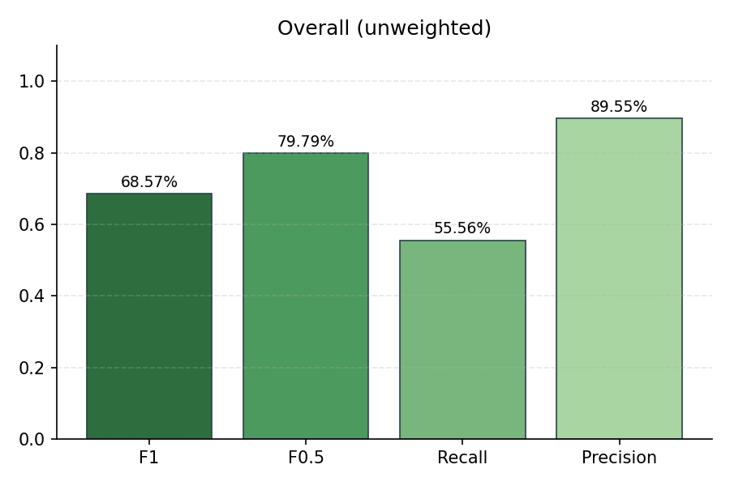

# Evaluation Summary

## Overall (unweighted)

| Metric | Value |
|--------|-------|
| Precision | 89.55% |
| Recall | 55.56% |
| F1 | 68.57% |
| F0.5 | 79.79% |
| Severity Score | 1589 |

## Overall (weighted)

| Metric | Value |
|--------|-------|
| Precision | 89.55% |
| Recall | 55.56% |
| F1 | 68.57% |
| F0.5 | 79.79% |
| Severity Score | 530 |

## Per-Subset Results

| Subset | TP | FP | FN | DUP | Precision | Recall | F1 | F0.5 | Severity |
|--------|----|----|----|----|-----------|--------|----|----|------|
| PAYGoat | 23 | 3 | 5 | 12 | 88.46% | 82.14% | 85.19% | 87.12% | 638 |
| Vulnbank | 26 | 3 | 34 | 2 | 89.66% | 43.33% | 58.43% | 73.86% | 706 |
| XBEN | 11 | 1 | 9 | 0 | 91.67% | 55.00% | 68.75% | 80.88% | 245 |

## Plots

